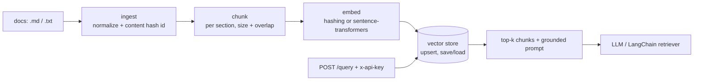

# rag-ingestion-pipeline

Document ingestion, heading-aware chunking, embeddings and retrieval for a RAG assistant, served through an API-key-protected FastAPI endpoint. Uses **synthetic policy documents only**.

It shows the data-engineering side of RAG: stable document ids, idempotent re-ingestion, chunks that never straddle sections, a persisted index, and a grounded prompt that cites its sources.



## Features

| Stage | What it does |
|---|---|
| `rag/ingest.py` | Unicode normalization, control-char stripping, SHA-256 content ids so the same file is never indexed twice |
| `rag/chunking.py` | Splits markdown by heading, then recursively by paragraph → line → sentence → word with configurable overlap |
| `rag/embeddings.py` | Deterministic offline `HashingEmbedder` for tests/CI; `SentenceTransformerEmbedder` for real use |
| `rag/store.py` | Cosine search, idempotent `upsert`, `save`/`load` to disk |
| `rag/langchain_adapter.py` | Wraps the store as a LangChain `BaseRetriever` |
| `rag/api.py` | FastAPI `/query` with API-key auth, request validation and a citation-style prompt |

## Quickstart

```bash
pip install -r requirements.txt
python scripts/generate_docs.py data/docs
RAG_DOCS=data/docs RAG_API_KEY=dev uvicorn rag.api:app --reload

curl -s localhost:8000/query -H 'x-api-key: dev' -H 'content-type: application/json' \
  -d '{"question": "How long do I have to return my modem?", "k": 3}'
```

## Tests

```bash
pytest -q
```

The tests cover chunk size and overlap, section boundaries, stable ids, idempotent re-ingestion, index persistence, retrieval relevance, and API auth and validation.

## Design notes

- **Content-hash ids:** re-running ingestion over the same folder adds nothing, so scheduled jobs are safe to retry.
- **Section-aware chunks:** each chunk carries its heading, which improves both retrieval and citations.
- **Pluggable embedder:** swap the hashing embedder for a model without touching the store or the API.
- **Next steps:** a managed vector DB (pgvector / Databricks Vector Search), incremental deletes, and retrieval evaluation (recall@k on labelled questions).
